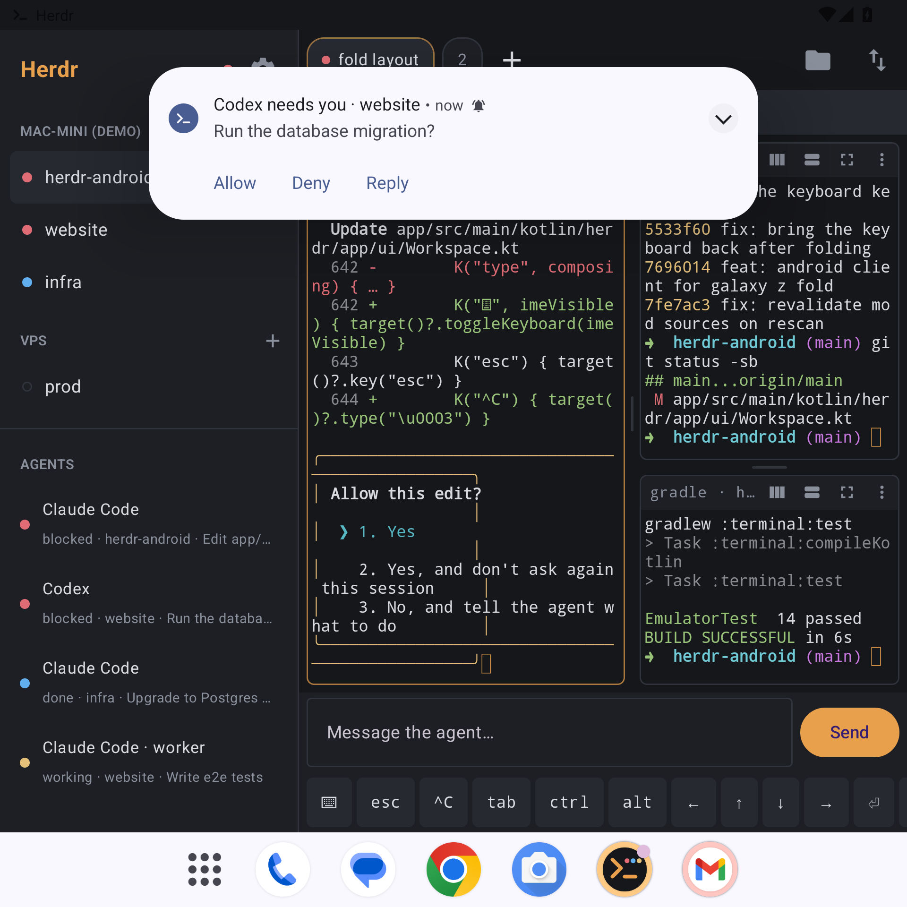
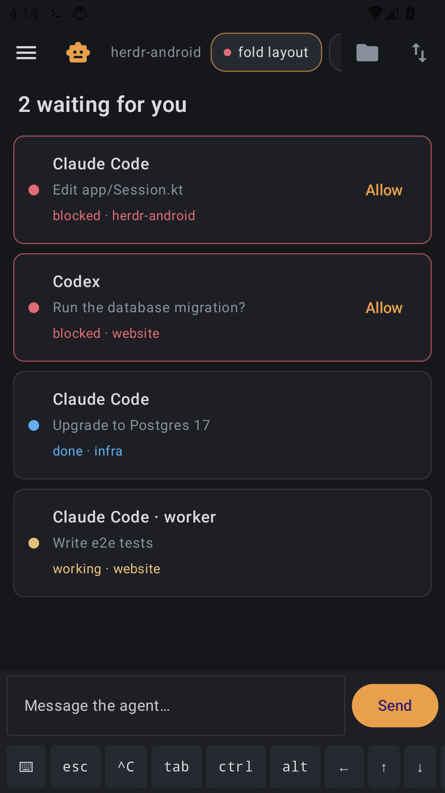
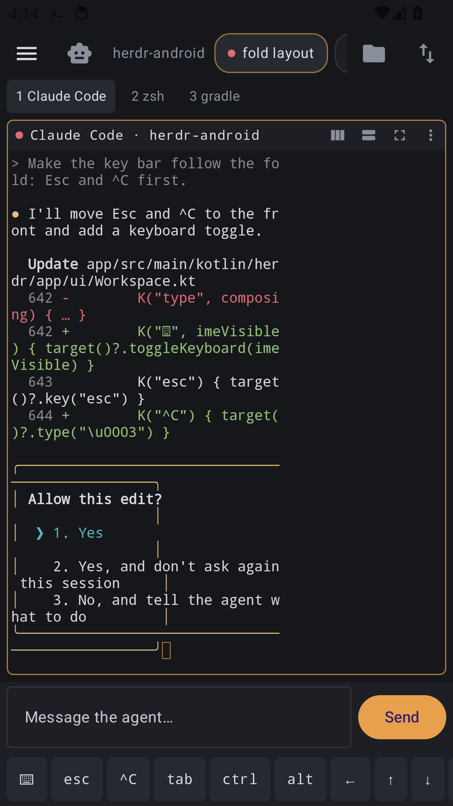
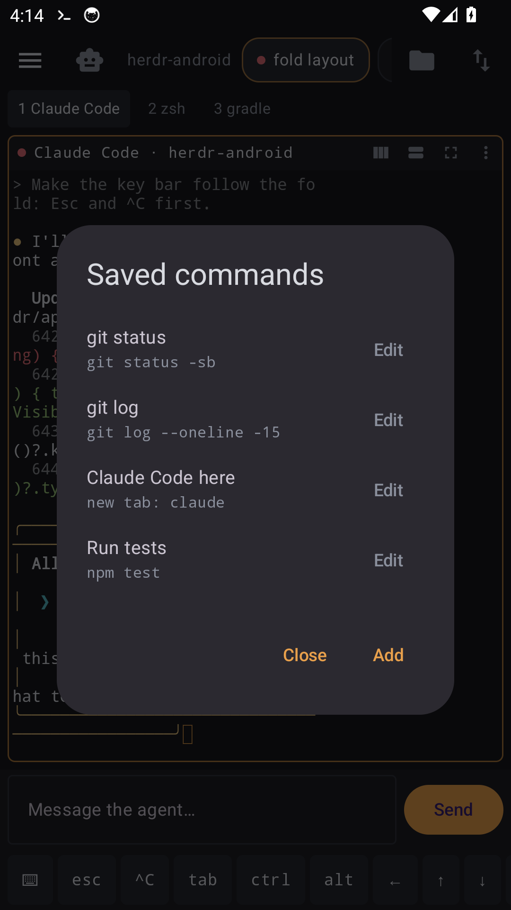

# Herdr for Android

**Your Mac's terminals and coding agents, on your phone.** An unofficial,
community Android client for [Herdr](https://github.com/herdrdev/herdr-app),
built for the Galaxy Z Fold 7 and fine on any Android 10+ phone.

It connects to **herdr-core on your Mac** over SSH and shows the same spaces,
tabs, splits and agents as the Herdr desktop app, live in both directions.
Terminals keep running on the Mac when the phone sleeps, loses signal or the
app closes.



| Folded: your agents | Folded: a terminal | Saved commands |
|---|---|---|
|  |  |  |

*Screenshots show the built-in demo (sample data, no Mac).*

> Not made by or affiliated with the Herdr project. Herdr and herdr-core are
> theirs; this app speaks herdr-core's public protocol.

## What you get

- **Your spaces, tabs and splits**, shared with the desktop app: make a space
  or split on the phone and the Mac window follows, and the other way round.
- **Agents**: every agent that reports status, blocked → done → working →
  idle. Tap one to jump to it; a worker without a pane opens in a peek.
- **Notifications** when an agent needs you or finishes, with **Allow**,
  **Deny** and **Reply** right in the notification.
- **Fold-aware layout**: sidebar beside your splits when unfolded; folded, the
  cover screen opens on your agents and shows one pane at a time. Folding
  never restarts anything.
- **A native terminal**: truecolor, emoji and wide characters, mouse
  reporting, smooth scrollback with fling, long-press to copy, pinch to zoom,
  a key bar (Esc, ^C, Ctrl/Alt, arrows, …) and hardware keyboards.
- **Type box**: write to an agent with your keyboard's autocorrect, swipe and
  voice typing, sent in one go.
- **Saved commands** (⚡): one tap types `git status` or starts Claude Code in
  a new tab.
- **Home-screen widget**: blocked / done / working at a glance.
- **Files and Changes** panels for the focused terminal's folder.
- **App lock** with fingerprint, face or PIN.
- **Other machines** you added on the Mac (`hc machine add`) show up too.

Not on the phone: Herdr desktop mods and layouts (they're drawn by the
desktop's renderer). Mod panes show as placeholders.

## Install

1. On the phone, open the [latest release](../../releases/latest) and download
   `herdr-android-<version>.apk`.
2. Open it and allow installing from your browser when Android asks.

To get updates automatically, add this repository's URL to
[Obtainium](https://github.com/ImranR98/Obtainium).

Want to look first? On the connect screen, tap **Try the demo**.

## Set up your Mac

1. **Remote Login**: System Settings → General → Sharing → Remote Login: on.
2. **herdr-core** 0.1.11 or newer: `hc --version` in Terminal. The Herdr
   desktop app installs it; or `curl -fsSL https://releases.herdr.dev/core/install.sh | sh`.
3. **Keep it awake**: System Settings → Energy → prevent automatic sleeping,
   and wake for network access.

### Away from home: Tailscale

Your Mac's `.local` name only works on your own Wi-Fi. Install
[Tailscale](https://tailscale.com) on the Mac and the phone (same account) and
use the Mac's Tailscale name (e.g. `mac-mini`) as the address. The app
reconnects by itself when you switch networks.

## Connect

1. Enter the Mac's address and your Mac user name (`whoami`).
2. Sign in with **this phone's key** (recommended): copy or share it, then on
   the Mac:
   ```sh
   mkdir -p ~/.ssh && chmod 700 ~/.ssh
   echo 'ssh-ed25519 AAAA… herdr-android' >> ~/.ssh/authorized_keys
   chmod 600 ~/.ssh/authorized_keys
   ```
   Or use your Mac password (stored encrypted on the phone).
3. Check the host key fingerprint against the Mac's
   (`for f in /etc/ssh/ssh_host_*_key.pub; do ssh-keygen -lf "$f"; done`).

| Problem | Fix |
|---|---|
| "Can't reach …" | Same network or Tailscale? Remote Login on? Mac awake? |
| "The Mac refused this phone's key" | Check `~/.ssh/authorized_keys`, or use the password. |
| "No hello … command not found: hc" | `which hc` on the Mac, then add its folder to the command under **Advanced**. |
| "herdr-core … too old" | `hc update` on the Mac. |

## Privacy

No accounts, no analytics, no servers of ours. The app talks only to your Mac.
See [PRIVACY.md](PRIVACY.md).

## Build

JDK 17 and the Android SDK (API 35).

```sh
./gradlew :protocol:test :terminal:test   # the core client and terminal engine, on the JVM
./gradlew :app:assembleDebug              # app/build/outputs/apk/debug/app-debug.apk
```

- `protocol/`: herdr-core's framed protocol (JSON-RPC, attach streams with
  credits, events), the shared layout document, and a demo core. Ported from
  the Herdr desktop app's `src/hc.rs`, `src/layout.rs` and `src/mirror.rs`.
- `terminal/`: the VT/xterm engine, tested with split, garbage and oversized input.
- `app/`: the Android app (Jetpack Compose; a Canvas view for terminals).

Releases: [RELEASING.md](RELEASING.md).

## Credits and license

Apache-2.0 (see [LICENSE](LICENSE) and [NOTICE](NOTICE)). Protocol and layout
code is ported from the [Herdr desktop app](https://github.com/herdrdev/herdr-app)
(Apache-2.0). The terminal's design follows ideas from
[Terminal Spike](https://github.com/Anderbone/terminal-spike)'s design notes;
no code was taken from it.
